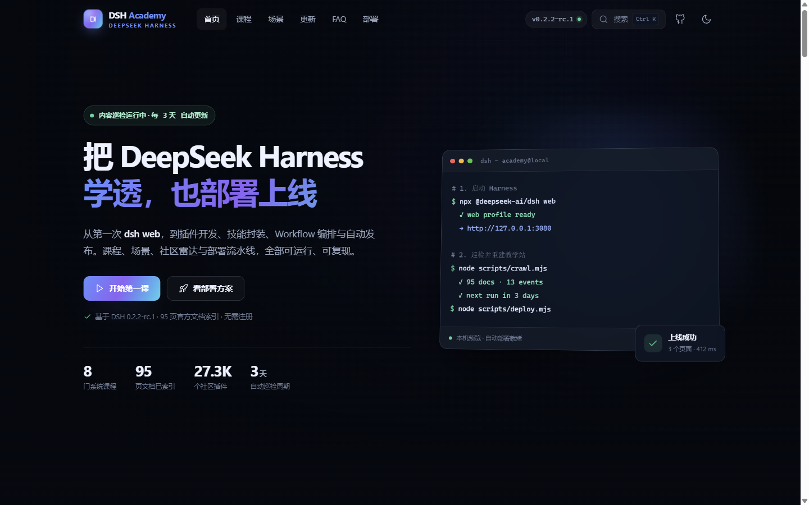

# DSH Academy

> 一座会自己更新的 DeepSeek Harness 中文教学站：课程、场景、社区雷达，以及从巡检到上线的完整自动化流水线。



DSH Academy 不是一个静态的「文档搬运站」。它把三件事做成了一个闭环：

1. **教**：8 门系统课程、6 个可复用场景、14 条排障手册，内容来自 DeepSeek Harness 官方文档与实测。
2. **盯**：每 3 天自动巡检 npm、GitHub Releases、95 页官方文档指纹与社区插件，只把真正的变化写进时间线。
3. **发**：巡检 → 构建 → 验收 → 发布全部脚本化，支持本机、GitHub Pages、Docker、Netlify 四种落点。

站点是纯静态产物（约 8 MB），零运行时依赖，可以直接扔进任意静态服务器、对象存储或 CDN。

---

## 目录

- [快速开始](#快速开始)
- [命令一览](#命令一览)
- [内容从哪来：巡检器](#内容从哪来巡检器)
- [每 3 天自动更新](#每-3-天自动更新)
- [部署到线上](#部署到线上)
- [项目结构](#项目结构)
- [二次开发](#二次开发)
- [验收清单](#验收清单)
- [说明与边界](#说明与边界)

---

## 快速开始

要求：**Node.js ≥ 20**（无需 `npm install`，项目没有任何第三方运行时依赖）。

```powershell
cd dsh-academy

# 1. 抓一次官方数据（约 10-15 秒）
node scripts/crawl.mjs

# 2. 生成静态站点到 dist/
node scripts/build.mjs

# 3. 启动本地预览（后台运行，PID 写入 data/server.pid）
node scripts/deploy.mjs --target local --port 4173

# 打开 http://127.0.0.1:4173/
```

也可以一条命令完成构建 + 预览：

```powershell
npm run preview
```

> 当前机器上若 `npm.ps1` 被执行策略拦截，直接用 `node scripts/...` 即可，功能完全一致。

---

## 命令一览

| 命令 | 作用 |
|---|---|
| `npm run crawl` | 巡检 npm / GitHub Releases / 官方文档 / 社区插件，写入 `site/data/` |
| `npm run build` | 由 `content/*.json` + `site/data/*.json` 生成 `dist/` |
| `npm run verify` | 发布前验收：页面、死链、资源、搜索索引、SEO 字段 |
| `npm run serve` | 零依赖静态服务器（前台运行） |
| `npm run preview` | 构建 + 前台预览 |
| `npm run deploy -- --target local` | 后台启动本地服务 |
| `npm run deploy -- --target github` | 通过 Git Data API 发布到 GitHub Pages |
| `npm run deploy -- --target netlify` | 打包并上传到 Netlify |
| `npm run deploy -- --target docker` | 构建镜像并启动容器 |
| `npm run ship` | 巡检 + 构建 + 部署（默认 local） |
| `npm run video` | 用 ffmpeg 重新生成导览视频与封面 |
| `npm run refresh` | 只做巡检 + 构建，不部署 |

Windows 一键脚本：

```powershell
powershell -ExecutionPolicy Bypass -File deploy\deploy.ps1 -Target local -Port 4173
```

---

## 内容从哪来：巡检器

`scripts/crawl.mjs` 没有任何依赖，直接使用 Node 内置 `fetch`。每轮会访问：

| 数据源 | 抓什么 | 失败时 |
|---|---|---|
| npm Registry | `@deepseek-ai/dsh` 最新版本、dist-tags | 标记数据源失败，保留旧数据 |
| GitHub Releases | `releases.atom`，不占用 REST API 配额 | 标记失败，保留旧时间线 |
| 官方文档 | 从 `llms.txt` 解析 95 个中文页面，ETag + SHA-256 指纹 | 失败页面沿用上次哈希 |
| GitHub Issues | 仓库议题（当前仓库未启用 Issues，通常为 0） | 降级，使用精选 FAQ 兜底 |
| 社区插件 | `topic:dsh-plugin` 最近更新 + 高星项目 | 降级，保留上次榜单 |

产物：

```text
site/data/updates.json      时间线事件（最多 300 条，按时间倒序）
site/data/meta.json         巡检状态、数据源健康、下次巡检时间
site/data/docs.json         95 页文档索引（按分区）
site/data/plugins.json      社区插件雷达
site/data/crawl-report.json 本轮完整报告
data/state.json             增量状态（版本、文档哈希、ETag、已知事件）
reports/crawl-latest.json   最近一次报告（归档在 reports/）
```

设计要点：

- **增量**：文档带 `If-None-Match` / `If-Modified-Since`，未变化时返回 304，避免每轮重新下载几 MB。
- **去重**：事件有稳定 id（`npm-<version>`、`gh-<atom id>`、`docs-<date>-<hash>`），重复运行不会刷屏。
- **可恢复**：单个数据源失败不会中断整轮；只有 npm / releases / docs 同时失败才以非 0 退出。
- **可审计**：每轮输出 `reports/crawl-*.json`，记录每个源的 HTTP 状态、耗时与错误。

---

## 每 3 天自动更新

### 方式 A：Windows 计划任务（本机 / 内网）

```powershell
# 注册自动更新任务 + 登录启动项（当前用户，无需管理员）
powershell -ExecutionPolicy Bypass -File deploy\register-tasks.ps1

# 立即跑一轮，验证链路
schtasks /Run /TN "DSHAcademy-Refresh"

# 查看状态
schtasks /Query /TN "DSHAcademy-Refresh" /V /FO LIST
```

- `DSHAcademy-Refresh`：每 3 天 03:00 执行 `crawl → build`；若已设置 `GITHUB_TOKEN` / `GITHUB_REPO`，随后自动发布到 Pages。
- 登录启动项 `DSH Academy Preview`：在启动文件夹创建快捷方式，登录时后台启动 `http://127.0.0.1:4173/`。
- 日志：`reports/task-refresh.log`、`reports/task-serve.log`。

移除：

```powershell
powershell -ExecutionPolicy Bypass -File deploy\unregister-tasks.ps1
```

### 方式 B：GitHub Actions（公网仓库）

仓库内置 `.github/workflows/update-and-deploy.yml`：

- `cron: '0 3 */3 * *'`：每 3 天 03:00 UTC 巡检、构建并发布 Pages。
- 也支持 `workflow_dispatch` 手动触发，以及 `main` 分支代码变更时自动构建。
- 巡检结果会以 `chore: refresh content [skip ci]` 提交回仓库，让下一轮仍能增量对比。
- 首次使用：仓库 **Settings → Pages → Source: GitHub Actions**。

### 方式 C：手动 / 自己的调度器

```powershell
npm run refresh
```

把这一条挂到 cron、Jenkins、群晖任务计划或任何 CI 都可以。

---

## 部署到线上

### 1. 本机 / 内网

```powershell
node scripts/build.mjs
node scripts/deploy.mjs --target local --port 4173
```

服务会脱离终端后台运行，PID 写入 `data/server.pid`。停止：

```powershell
node scripts/deploy.mjs --target local --stop
```

### 2. GitHub Pages

需要一个有 `repo` 权限的 Personal Access Token：

```powershell
$env:GITHUB_TOKEN = "ghp_xxx"
$env:GITHUB_REPO  = "your-name/dsh-academy"
$env:SITE_BASE_PATH = "/dsh-academy/"   # 用户主页仓库请删除这一行
node scripts/build.mjs
node scripts/deploy.mjs --target github --branch gh-pages
```

脚本通过 Git Data API 直接创建 blob / tree / commit / ref，**不需要本地安装 git**，也不会改写你的工作区。首次部署后到仓库 **Settings → Pages** 选择 `gh-pages` 分支。

### 3. Docker

```powershell
node scripts/build.mjs       # Dockerfile 内也会重新构建，可跳过
docker build -t dsh-academy .
docker run -d --name dsh-academy -p 8080:80 --restart unless-stopped dsh-academy
```

或：

```powershell
node scripts/deploy.mjs --target docker --port 8080
```

镜像为多阶段构建：Node 只负责生成静态产物，运行阶段是 Nginx，不包含源码与爬虫。健康检查：`/healthz`。

> 需要本机已安装 Docker Desktop；未安装时 `--target docker` 会明确报错，不影响其他部署路径。

### 4. Netlify

```powershell
$env:NETLIFY_AUTH_TOKEN = "nfp_xxx"
$env:NETLIFY_SITE_ID    = "xxxxxxxx-xxxx-xxxx"
node scripts/build.mjs
node scripts/deploy.mjs --target netlify
```

脚本用 PowerShell `Compress-Archive` 打包 `dist/`，调用 Netlify Deploy API 并轮询到 `ready`。

### 环境变量

| 变量 | 用途 |
|---|---|
| `GITHUB_TOKEN` | GitHub PAT（repo 权限） |
| `GITHUB_REPO` | `owner/name` |
| `GITHUB_BRANCH` | 发布分支，默认 `gh-pages` |
| `NETLIFY_AUTH_TOKEN` | Netlify 个人令牌 |
| `NETLIFY_SITE_ID` | Netlify 站点 ID |
| `SITE_BASE_PATH` | 子路径部署，如 `/dsh-academy/` |
| `SITE_URL` | 生成 sitemap / RSS 的绝对地址 |
| `PORT` | 本地服务端口，默认 4173 |

验证：

```powershell
Invoke-WebRequest http://127.0.0.1:4173 -UseBasicParsing | Select-Object StatusCode
Invoke-WebRequest http://127.0.0.1:4173/faq/ -UseBasicParsing | Select-Object StatusCode
```

---

## 项目结构

```text
dsh-academy/
├── scripts/
│   ├── crawl.mjs            # 多源巡检（npm / releases / docs / issues / plugins）
│   ├── build.mjs            # 静态站点生成器
│   ├── verify.mjs           # 发布前验收（死链 / 资源 / 索引 / SEO）
│   ├── serve.mjs            # 零依赖静态服务器（gzip / ETag 语义 / 404）
│   ├── deploy.mjs           # local / github / netlify / docker
│   ├── make-video.mjs       # ffmpeg 生成 30s 导览 + 首页背景循环
│   ├── pages.mjs            # 页面模板（首页 / 课程 / 更新 / FAQ / 部署）
│   └── lib/
│       ├── common.mjs       # 路径、JSON、HTTP、转义工具
│       └── ui.mjs           # 布局、图标、代码块、卡片组件
├── content/
│   ├── courses.json         # 8 门课程（步骤 / 坑 / 验收清单）
│   ├── faqs.json            # 14 条排障手册
│   ├── scenarios.json       # 6 个实战场景
│   └── sources/             # 官方文档原文摘录（写作依据）
├── site/
│   ├── assets/css/main.css  # 设计系统（深/浅色、响应式）
│   ├── assets/js/app.js     # 搜索、进度、筛选、部署向导、主题
│   ├── assets/img/          # 封面、图标
│   ├── assets/video/        # 30s 导览 + 12s 首页循环
│   └── data/                # 巡检产物（构建输入）
├── deploy/
│   ├── register-tasks.ps1   # Windows 计划任务
│   ├── refresh.ps1          # 巡检 + 构建 + 可选发布
│   ├── serve.ps1            # 登录自启
│   ├── deploy.ps1           # 一键脚本
│   └── nginx.conf           # Docker 运行配置
├── .github/workflows/update-and-deploy.yml
├── Dockerfile
└── dist/                    # 构建产物（可直接托管）
```

技术选择：**零第三方依赖**。模板是普通字符串，搜索是客户端 JSON，视频由 ffmpeg 生成。这样部署时不需要 `npm install`，也不会被供应链问题拖住。

---

## 二次开发

### 改课程 / FAQ / 场景

直接编辑 `content/*.json`，然后 `npm run build`。课程页会按 `slug` 自动生成，并自动串好上一课 / 下一课。

课程字段（最小集）：

```json
{
  "slug": "my-lesson",
  "order": 9,
  "title": "课程标题",
  "level": "进阶",
  "duration": 20,
  "summary": "一句话说明",
  "objectives": ["学完能做什么"],
  "steps": [{ "title": "步骤", "body": "说明", "code": { "lang": "sh", "content": "echo hi" }, "tip": "可选" }],
  "pitfalls": [{ "problem": "现象", "fix": "处理" }],
  "checklist": ["验收项"],
  "links": [{ "label": "官方文档", "url": "https://..." }]
}
```

FAQ 字段：`id / question / answer / tags / symptoms / cause / fix / commands / links / hot`。

### 改设计

- 颜色、字号、圆角：`site/assets/css/main.css` 顶部的 CSS 变量。
- 首页文案与模块顺序：`scripts/pages.mjs` 的 `homePage`。
- 导航项：`scripts/lib/ui.mjs` 的 `navItems`。

### 换视频

```powershell
npm run video
```

需要本机有 `ffmpeg` 和 Windows 中文字体（微软雅黑、Consolas）。脚本会重写：

- `site/assets/video/dsh-academy.mp4`（30 秒，1080p，无音轨）
- `site/assets/video/hero-loop.mp4`（12 秒无文字背景循环）
- `site/assets/img/tour-poster.jpg` / `hero-poster.jpg`

### 加数据源

在 `scripts/crawl.mjs` 里新增一个 `crawlXxx(state)` 函数，返回 `{ status, items, note }`，把事件 push 进 `newEvents`，然后在 `main()` 里 `runSource(...)` 注册即可。事件只要 id 稳定，就会自动去重。

---

## 验收清单

发布前建议逐项确认（本地实测已覆盖）：

- [x] `node scripts/crawl.mjs` 五个数据源均返回 OK / DEGRADED，并有 `reports/crawl-latest.json`
- [x] `node scripts/build.mjs` 生成 15 个页面、136 条搜索索引、RSS、sitemap
- [x] `node scripts/verify.mjs` 验收通过（内部链接、必需资源、搜索索引）
- [x] 首页 / 课程 / 课程详情 / 场景 / 更新 / FAQ / 部署 / 404 全部 200
- [x] 桌面 1440px 与移动 390px 均无横向滚动
- [x] 搜索面板（Ctrl K）可检索课程、FAQ、场景、文档
- [x] FAQ 标签筛选 + 关键词搜索可用
- [x] 课程进度写入 `localStorage`，刷新后保留
- [x] 部署向导可生成四条路径的命令并可复制
- [x] 深色 / 浅色主题可切换且无闪白
- [x] 视频本地托管，无外部 CDN 请求
- [x] `node scripts/deploy.mjs --target local` 后台启动，`/healthz` 返回 200

---

## 说明与边界

- DeepSeek Harness 目前是 **开发者预览（0.2.2-rc.1）**，接口与行为可能变化；课程里标注的版本与命令以官方文档为准。
- 社区插件描述来自 GitHub，属于外部不可信内容；本站只做索引，不背书、不自动安装。插件以你的权限运行，装前读源码。
- 巡检器不绕过任何登录或限流；GitHub API 无 token 时可能被限流，此时会降级并保留旧数据，不影响站点可用性。
- 本站不是 DeepSeek 官方站点，是一个面向中文学习者的教学与工程实践项目。DeepSeek Harness 本身以官方仓库与文档为准。

## 参考

- [DeepSeek Harness 官网](https://www.deepseek.com/harness/)
- [DeepSeek Harness 文档](https://deepseek-harness.github.io/deepseek-harness/)
- [GitHub 仓库](https://github.com/deepseek-ai/deepseek-harness)
- [插件话题](https://github.com/topics/dsh-plugin)

MIT License · 内容与代码可自由修改，保留出处即可。
